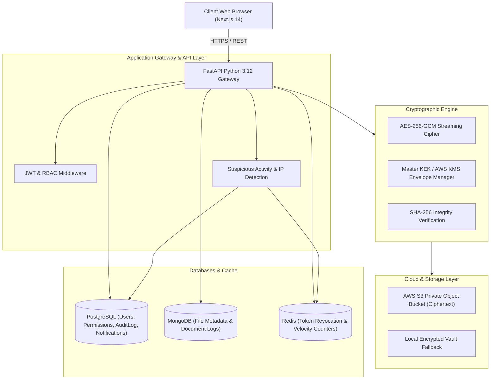
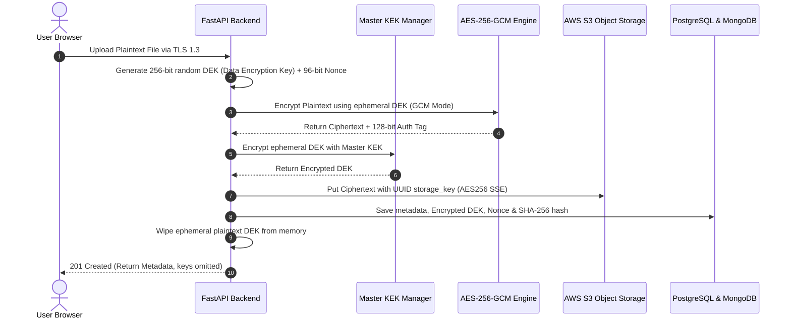
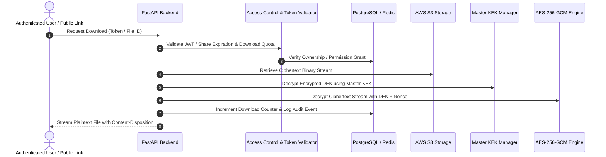

# TrustShare – Enterprise Architecture & Cryptographic Design

## 1. System Overview

**TrustShare** is a zero-knowledge cloud file sharing and digital collaboration platform engineered for confidentiality, integrity, access control, and threat prevention. Plaintext data is never written to disk or transmitted across untrusted networks.

---

## 2. High-Level Architecture Diagram

---

## 3. Cryptographic Pipeline: AES-256-GCM Envelope Encryption

TrustShare utilizes **Envelope Encryption** adhering to NIST SP 800-57 guidelines:

---

## 4. Secure File Download & Decryption Pipeline

---

## 5. Security & Threat Prevention Subsystem

1. **Brute Force Protection**: Failed logins tracked in Redis/memory sliding window (5 failed attempts in 10 min trigger security alert + audit log).
2. **Exfiltration Burst Defense**: Monitors download velocity per user session (>10 downloads in 5 min flags incident).
3. **Anomalous IP Detection**: Alerts users on logins originating from unseen IPs.
4. **Token Revocation**: Distributed JWT session invalidation via Redis token blacklisting.
