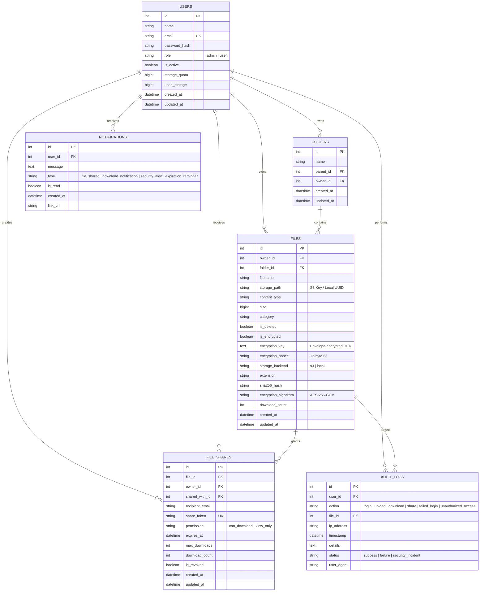

# TrustShare – Database Schema & Data Modeling

TrustShare implements a multi-database architecture:
- **PostgreSQL**: Relational integrity for user accounts, roles, access permissions, immutable audit trail, and notifications.
- **MongoDB**: Document store for rich file metadata, tags, and document-level audit logs.
- **Redis**: High-speed in-memory store for JWT token blacklists, rate limits, and threat velocity counters.

---

## 1. PostgreSQL Entity Relationship Diagram (ERD)



---

## 2. MongoDB Document Schemas

### Collection: `files`
```json
{
  "_id": "6724a8...",
  "id": "1",
  "original_name": "Quarterly_Financials.pdf",
  "stored_name": "vault/9a5f-4a0b-93e1-329b3c4a17.bin",
  "storage_key": "vault/9a5f-4a0b-93e1-329b3c4a17.bin",
  "storage_backend": "s3",
  "file_size": 2489020,
  "content_type": "application/pdf",
  "extension": ".pdf",
  "category": "pdf",
  "sha256_hash": "e3b0c44298fc1c149afbf4c8996fb92427ae41e4649b934ca495991b7852b855",
  "owner_id": 1,
  "owner_email": "alice@trustshare.io",
  "description": "Board review financial reports",
  "upload_date": "2026-09-23T12:00:00Z",
  "download_count": 4,
  "is_public": false,
  "encryption_algorithm": "AES-256-GCM",
  "encrypted_dek": "8f9a2b...",
  "nonce": "3d5f1c...",
  "shares": [
    {
      "share_token": "a1b2c3d4e5f67890...",
      "share_url": "/share/a1b2c3d4e5f67890...",
      "permission": "can_download",
      "expires_at": "2026-09-30T12:00:00Z",
      "max_downloads": 10,
      "download_count": 4
    }
  ]
}
```

### Collection: `audit_logs`
```json
{
  "_id": "6724b1...",
  "sql_id": 104,
  "user_id": 1,
  "action": "download",
  "file_id": 1,
  "ip_address": "192.168.1.50",
  "timestamp": "2026-09-23T12:15:30Z",
  "details": "Downloaded file 'Quarterly_Financials.pdf'",
  "status": "success",
  "user_agent": "Mozilla/5.0 (Windows NT 10.0; Win64; x64)"
}
```

---

## 3. Redis Key Structure

| Key Pattern | Data Type | TTL | Purpose |
| :--- | :--- | :--- | :--- |
| `revoked_token:<jwt_hash>` | String | Token expiry | Blacklisted JWT session tokens |
| `file_cache:<file_id>` | Hash/JSON | 300 seconds | Cached file metadata for high-throughput reads |
| `download_burst:<user_id/ip>` | Sorted Set / Counter | 300 seconds | Velocity rate limiting for mass download defense |
| `failed_logins:<email>:<ip>` | List / Set | 600 seconds | Brute force attempt tracker |
