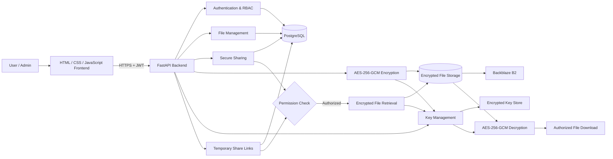

# TrustShare System Architecture

## 1. Overview

TrustShare is a secure file-sharing and digital collaboration platform. Users can upload, organize, manage, and share files through controlled permissions and temporary share links.

For Milestone 2, the system adds **AES-256-GCM file encryption, secure cloud storage using Backblaze B2, encryption key management, secure file sharing, access permissions, temporary link expiration, and secure file decryption**.

The system uses HTML, CSS, and JavaScript for the frontend, FastAPI for backend APIs, PostgreSQL for core data, AES-256-GCM for file encryption, Backblaze B2 for encrypted file storage, JWT for authentication, and an encrypted key store for protecting file encryption keys.

## 2. Technology Stack

| Layer | Technology | Purpose |
|---|---|---|
| Frontend | HTML + CSS + JavaScript | User interface |
| Backend | Python + FastAPI | REST APIs, business logic, security controls |
| Primary Database | PostgreSQL | Users, folders, files, permissions, share links and downloads |
| Authentication | JWT | Secure user authentication |
| Password Security | bcrypt | Secure password hashing |
| File Encryption | AES-256-GCM | Encrypt and decrypt files |
| Key Management | Encrypted Key Store | Protect file encryption keys |
| File Storage | Backblaze B2 | Store encrypted file data |

## 3. High-Level Request Flow

1. A user accesses the TrustShare web application.
2. The frontend sends requests to the FastAPI backend.
3. FastAPI authenticates the user using JWT.
4. The backend checks user roles, file ownership, and permissions.
5. During upload, the file is encrypted using AES-256-GCM.
6. The encryption key is protected using the master encryption key.
7. The encrypted file is stored in Backblaze B2.
8. File metadata and encryption key references are stored in PostgreSQL.
9. Files can be securely shared using permissions or temporary share links.
10. During retrieval, the backend verifies access, recovers the encryption key, decrypts the file, and provides it to the authorized user.

## 4. High-Level Architecture Diagram


## 5. Component Responsibilities
**HTML / CSS / JavaScript Frontend**
- Registration and login
- File upload and management
- File and folder browsing
- File sharing
- Permission selection
- Temporary share-link creation
- File download
- Admin user management
**FastAPI Backend**
- Validates API requests
- Authenticates users using JWT
- Enforces roles and file permissions
- Handles file upload and retrieval
- Encrypts and decrypts files
- Manages encryption keys
- Manages secure file sharing
- Handles temporary share links and expiration
- Controls authorized downloads
**PostgreSQL**

Stores:

- User information
- Folder information
- File metadata
- File versions
- File permissions
- Share links
- Download records
- Encryption key references

Actual file content is not stored directly in PostgreSQL.

**AES-256-GCM Encryption**

Protects uploaded files before they are stored in cloud storage.
```
Original File
     ↓
AES-256-GCM Encryption
     ↓
Encrypted File
     ↓
Backblaze B2
```
**Backblaze B2**

Stores the encrypted file data.

Only encrypted files are uploaded to Backblaze B2. The database stores the storage key and other file metadata.

**Key Management**

Each file uses its own encryption key.
```
File Encryption Key
        ↓
Master Encryption Key
        ↓
Encrypted Key Store
```
The database stores only an encryption key reference, while the protected key is maintained separately.
