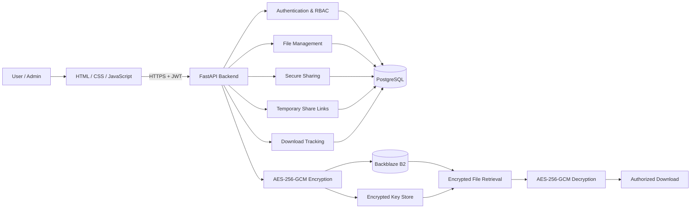

# TrustShare System Architecture

## 1. Overview

TrustShare is a secure file-sharing and digital collaboration platform. Users can upload, manage, organize, and share files using controlled permissions and temporary share links.

The system uses HTML, CSS, and JavaScript for the frontend, FastAPI for backend APIs, PostgreSQL for application data, AES-256-GCM for file encryption, Backblaze B2 for encrypted file storage, JWT for authentication, and an encrypted key store for key management.

## 2. Technology Stack

| Layer | Technology | Purpose |
|---|---|---|
| Frontend | HTML + CSS + JavaScript | User interface |
| Backend | Python + FastAPI | APIs and business logic |
| Database | PostgreSQL | Users, files, permissions and sharing data |
| Authentication | JWT | User authentication |
| Password Security | bcrypt | Password hashing |
| Encryption | AES-256-GCM | File encryption and decryption |
| File Storage | Backblaze B2 | Encrypted file storage |
| Key Management | Encrypted Key Store | Protect encryption keys |

## 3. High-Level Request Flow

1. User accesses the TrustShare web application.
2. Frontend sends requests to the FastAPI backend.
3. JWT authentication verifies the user.
4. Backend checks roles, ownership, and permissions.
5. Files are encrypted using AES-256-GCM.
6. Encrypted files are stored in Backblaze B2.
7. File metadata is stored in PostgreSQL.
8. Authorized users can securely retrieve and download files.

## 4. High-Level Architecture Diagram


## 5. Component Responsibilities
**Frontend**
- User registration and login
- File management
- File sharing
- Permission management
- Temporary share links
- File downloads
- Admin dashboard
**FastAPI Backend**
- Authentication and authorization
- File upload and management
- Encryption and decryption
- Secure file sharing
- Permission checking
- Temporary link management
- Download tracking
**PostgreSQL**

Stores users, folders, files, file versions, permissions, share links, and download records.

**Backblaze B2**

Stores encrypted file data. Original unencrypted files are not stored in cloud storage.

**Key Management**

Generates and protects file encryption keys using a master encryption key.

## 6. Secure File Sharing

Users can share files with registered users using View or Download permissions.
```
Sender
  ↓
Select File
  ↓
Select User
  ↓
Set Permission
  ↓
Shared File
```
## 7. Temporary Share Links

Temporary links provide controlled file access using expiration time, download limits, and link revocation.
```
Create Link
    ↓
Set Expiration
    ↓
Set Download Limit
    ↓
Secure Share Link
    ↓
Access File
```
## 8. File Retrieval and Decryption

Files are decrypted only after authentication and permission verification.
```
User Request
     ↓
JWT Authentication
     ↓
Permission Check
     ↓
Retrieve Encrypted File
     ↓
Recover Encryption Key
     ↓
AES-256-GCM Decryption
     ↓
Authorized Download
```
## 9. Security Architecture
- JWT authentication
- bcrypt password hashing
- Role-based access control
- AES-256-GCM encryption
- Protected encryption keys
- Permission-based access
- Temporary link expiration
- Download limits
- Secure file decryption
## 10. Production Design Principles
- Use HTTPS for communication
- Store secrets in environment variables
- Encrypt files before cloud storage
- Protect encryption keys separately
- Verify authorization for protected requests
- Keep sensitive credentials out of GitHub
- Use secure cloud storage and database management
