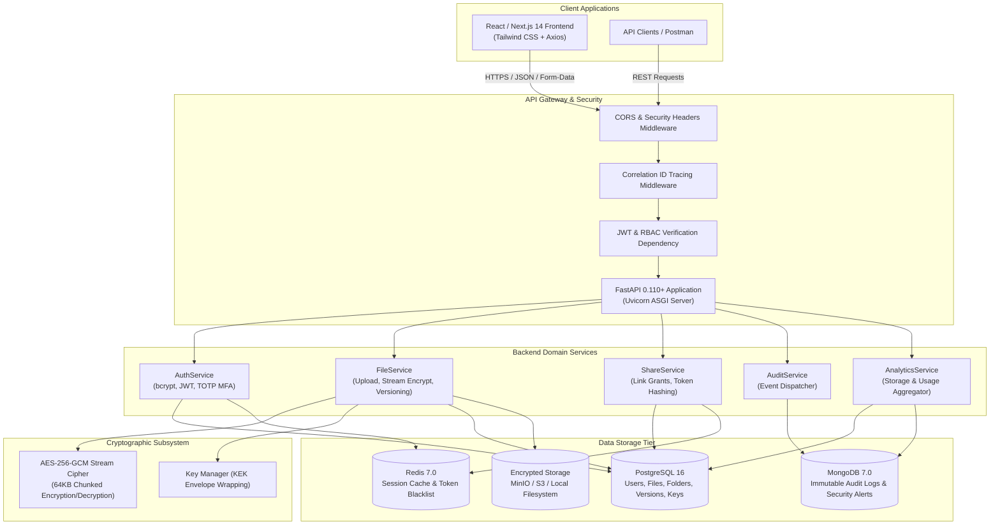
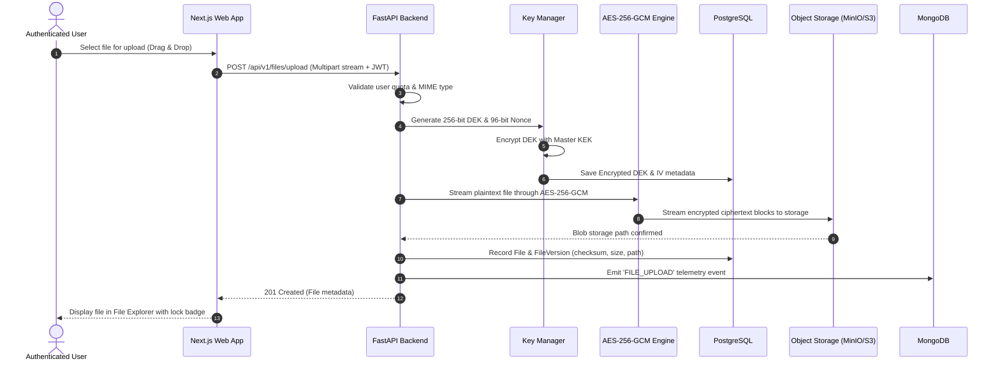
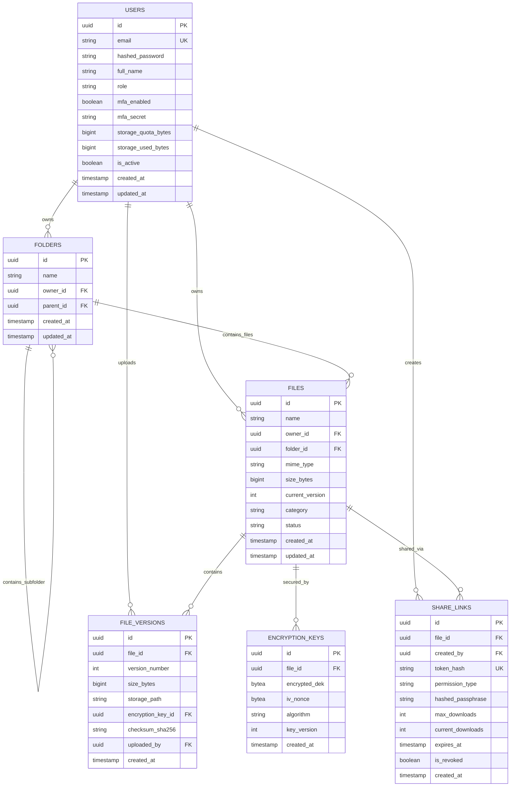

# Milestone 1: System Architecture, Database Schema & Security Design

**Project**: TrustShare — Intelligent Encrypted File Sharing and Digital Collaboration Management Platform  
**Milestone**: 1 (Week 1 & 2) — Project Initialization, Design Process & Core Setup  

---

## 1. Executive Summary & System Objectives

TrustShare is an enterprise-grade secure file-sharing and digital collaboration system engineered with **Server-Side Zero-Exposure AES-256-GCM Envelope Encryption**. The core objective of Milestone 1 is to establish the complete foundational architecture, containerized infrastructure, multi-model persistence layer, cryptographic key hierarchy, authentication system, and end-to-end file ingestion workflow.

### Key Functional Objectives for Milestone 1:
- **Zero-Plaintext Storage**: All uploaded files are streamed and encrypted in 64 KB chunks using unique AES-256-GCM Data Encryption Keys (DEKs) before persistence.
- **Envelope Key Management**: DEKs are wrapped using a master Key Encryption Key (KEK) and stored securely in PostgreSQL.
- **Hybrid Polyglot Persistence**:
  - **PostgreSQL 16**: Relational consistency for users, permissions, folder hierarchies, file metadata, versions, and encrypted DEKs.
  - **MongoDB 7.0**: High-throughput, schemaless telemetry for audit trails and security event streams.
  - **Redis 7.0**: Low-latency token revocation blacklists, rate limiting, and temporary access caches.
  - **Object Storage (S3 / MinIO / Local)**: Encrypted ciphertext storage blobs.
- **Role-Based Access Control (RBAC)**: Fine-grained permissions for Administrators, Regular Users, and Guest Collaborators.

---

## 2. System Architecture Diagram

---

## 3. Cryptographic Workflow (Envelope Encryption)

---

## 4. Database Schema Design

### 4.1 PostgreSQL Relational Tables

### 4.2 MongoDB Telemetry Collections (`trustshare_telemetry`)

#### `audit_logs`
- `_id`: ObjectId
- `event_type`: string (`USER_LOGIN`, `FILE_UPLOAD`, `FILE_DOWNLOAD`, `SHARE_CREATED`, `ACCESS_REVOKED`)
- `user_id`: string (UUID)
- `resource_type`: string (`file`, `share`, `user`)
- `resource_id`: string (UUID)
- `ip_address`: string
- `user_agent`: string
- `correlation_id`: string (UUID)
- `metadata`: object (JSON details)
- `timestamp`: ISODate

#### `security_alerts`
- `_id`: ObjectId
- `alert_type`: string (`FAILED_LOGIN_ANOMALY`, `EXPIRED_LINK_ACCESS`, `UNAUTHORIZED_DOWNLOAD_ATTEMPT`)
- `severity`: string (`LOW`, `MEDIUM`, `HIGH`, `CRITICAL`)
- `user_id`: string (UUID, optional)
- `source_ip`: string
- `details`: object
- `resolved`: boolean
- `created_at`: ISODate

---

## 5. Security & RBAC Specifications

| Role | Permissions |
|---|---|
| **Admin** | Full system governance, view platform audit logs, manage storage quotas, monitor anomalies, manage all user records. |
| **User** | Create/delete folders, upload/download personal files, version files, generate expiring share links with passphrase protection. |
| **Viewer / Guest** | Read-only access to specific shared documents authorized via cryptographic share tokens. |

---

## 6. Milestone 1 Verification Checklist

- [x] Project workspace initialized with Next.js 14 frontend and FastAPI backend.
- [x] Docker Compose multi-container environment configured for PostgreSQL 16, MongoDB 7, Redis 7, MinIO.
- [x] Database schemas defined with SQLAlchemy 2.0 and Alembic migration environment.
- [x] Authentication service implemented with bcrypt password hashing, JWT access/refresh tokens, and PyOTP MFA.
- [x] AES-256-GCM stream cipher and envelope key management service implemented and tested.
- [x] Chunked file upload and decrypted streaming download implemented.
- [x] Frontend responsive file manager dashboard, drag-and-drop uploader, and version history modal built.
- [x] Test suite passing with 100% success rate across unit, contract, and integration tests.
