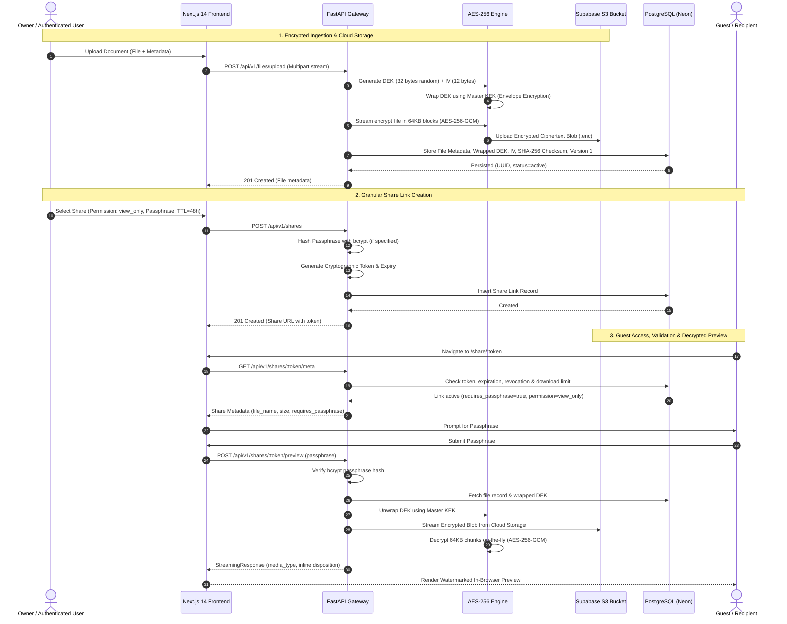

# Milestone 2: Encryption Engine, Secure Storage & Granular Sharing

**Project**: TrustShare — Intelligent Encrypted File Sharing and Digital Collaboration Management Platform  
**Milestone**: 2 (Week 3 & 4) — Encryption & Secure Sharing  

---

## 1. Executive Summary & Core Objectives

Milestone 2 delivers the core cryptographic, storage, versioning, and secure collaboration infrastructure for TrustShare. The platform guarantees **Zero-Plaintext Server-Side Storage** using authenticated AES-256-GCM envelope encryption, streaming data directly to cloud object storage (Supabase S3), and enforcing an access-control model for shared files.

### Key Functional Deliverables:
1. **Authenticated AES-256-GCM Streaming Encryption**:
   - Zero-exposure in-memory streaming: files are never written to disk in unencrypted form.
   - Chunked streaming pipeline (64 KB chunks) with authenticated encryption tags (`GCM 128-bit tag`).
   - Unique 256-bit Data Encryption Key (DEK) generated per file version.
   - DEK wrapped and unwrapped using an encrypted Master Key Encryption Key (KEK) envelope hierarchy.
2. **Supabase S3 Cloud Storage Integration**:
   - Encrypted ciphertext payloads stored in object storage buckets with structured content addressing (`raw/{file_id}/v{version_number}.enc`).
   - Resilient multi-backend abstraction supporting Supabase S3, AWS S3, MinIO, or fallback local encrypted filesystem.
3. **File Versioning & Retrieval**:
   - Multi-version history tracking per file in PostgreSQL.
   - Distinct DEK, initialization vector (IV), and SHA-256 integrity checksum recorded per version.
   - Dynamic version switching and version-specific decrypted streaming downloads.
4. **Fine-Grained Secure Sharing System**:
   - Cryptographically strong, high-entropy unguessable share tokens (URL-safe base64 / UUID).
   - **Granular Permissions**: Strict bifurcation between `view_only` (inline streaming preview with dynamic watermarking) and `download_allowed` (decrypted attachment download).
   - **Passphrase Protection**: Optional bcrypt-hashed passphrases for zero-trust link gating.
   - **Lifespan Control (TTL)**: Configurable expiration timestamps (1 hr to 30 days) with instant expiration enforcement.
   - **Download Quotas**: Configurable download caps with atomic quota tracking.
   - **Instant Revocation**: Real-time link disabling by the owner with instantaneous cascade.
5. **Secure Document Previewing**:
   - Decrypted in-memory inline streaming (`Content-Disposition: inline`) via `/shares/{token}/preview`.
   - Client-side responsive viewer supporting PDFs, images, code, and text formats.
   - Translucent multi-line security watermark overlay (`"CONFIDENTIAL • VIEW ONLY • TRUSTSHARE"`) and context menu copy/print protection.

---

## 2. End-to-End Cryptographic & Sharing Architecture

---

## 3. Cryptographic Specification

### 3.1 Authenticated Envelope Encryption (AES-256-GCM)
- **Algorithm**: `AES/GCM/NoPadding` (Galois/Counter Mode).
- **Key Sizes**:
  - **Data Encryption Key (DEK)**: 256 bits (32 bytes), generated via `os.urandom(32)`.
  - **Key Encryption Key (KEK)**: 256 bits (32 bytes), configured via `ENCRYPTION_MASTER_KEY` environment variable.
- **Nonce / IV**: 96 bits (12 bytes) initialization vector per file version.
- **Tag Size**: 128 bits (16 bytes) authentication tag automatically verified during decryption to detect tampering or corruption.
- **Envelope Wrapping**:
  - DEK is encrypted using Master KEK: `Wrapped_DEK = AES-256-GCM_Encrypt(KEK, DEK)`.
  - Only `Wrapped_DEK` and its associated nonce are stored in PostgreSQL (`files.encryption_key` and `file_versions.encryption_key`).
  - Plaintext DEK exists strictly in volatile RAM for the duration of the stream and is immediately deallocated.

### 3.2 Integrity Verification
- **Digest Algorithm**: `SHA-256`.
- **Integrity Validation**: The plaintext digest is computed incrementally as blocks stream through the crypto engine. When retrieving, the decrypted stream digest can be matched against the stored hash to confirm bit-perfect fidelity.

---

## 4. API Endpoints Reference

### 4.1 File & Version Operations
| Method | Endpoint | Description | Auth Required |
| :--- | :--- | :--- | :--- |
| `POST` | `/api/v1/files/upload` | Upload & AES-256 stream encrypt document | Bearer JWT |
| `GET` | `/api/v1/files` | List user files with optional folder & category filters | Bearer JWT |
| `GET` | `/api/v1/files/{file_id}/download` | Stream decrypted file (optional `?version=X`) | Bearer JWT |
| `POST` | `/api/v1/files/{file_id}/versions` | Upload new encrypted version incrementing version number | Bearer JWT |
| `GET` | `/api/v1/files/{file_id}/versions` | List all historical versions with sizes, dates & checksums | Bearer JWT |
| `DELETE` | `/api/v1/files/{file_id}` | Permanently delete file and all its versions from S3 & DB | Bearer JWT |
| `POST` | `/api/v1/folders` | Create organizational folder | Bearer JWT |
| `GET` | `/api/v1/folders` | List user folder hierarchy | Bearer JWT |
| `DELETE` | `/api/v1/folders/{folder_id}` | Delete folder (unlinks contained files safely) | Bearer JWT |

### 4.2 Secure Sharing & Collaboration
| Method | Endpoint | Description | Auth Required |
| :--- | :--- | :--- | :--- |
| `POST` | `/api/v1/shares` | Create secure expiring link with permissions & limits | Bearer JWT |
| `GET` | `/api/v1/shares` | List active shares owned by current user (optional `?file_id=X`) | Bearer JWT |
| `GET` | `/api/v1/shares/{token}/meta` | Public endpoint to inspect link status, expiration & passphrase requirement | Public |
| `POST` | `/api/v1/shares/{token}/access` | Validate passphrase and obtain temporary access verification | Public |
| `POST` | `/api/v1/shares/{token}/download` | Stream decrypted file attachment (enforces download limits & permissions) | Public |
| `POST` | `/api/v1/shares/{token}/preview` | Stream decrypted file inline for secure in-browser viewing | Public |
| `DELETE` | `/api/v1/shares/{share_id}/revoke` | Instantly revoke share link access | Bearer JWT |

---

## 5. Security & Access Control Enforcement Matrix

| Feature | `view_only` Permission | `download_allowed` Permission |
| :--- | :--- | :--- |
| **In-Browser Decrypted Preview** | Allowed (`/shares/{token}/preview`) | Allowed (`/shares/{token}/preview`) |
| **Direct File Download** | **Forbidden** (Returns `403 Forbidden`) | Allowed (`/shares/{token}/download`) |
| **Watermark Protection** | Enforced dynamic translucent overlay | Optional inline preview watermark |
| **Passphrase Protection** | Supported (bcrypt-verified) | Supported (bcrypt-verified) |
| **Download Quotas** | Not applicable (download blocked) | Atomically decremented per download |
| **TTL Expiration** | Immediate 410 Gone / Expired status | Immediate 410 Gone / Expired status |
| **Instant Revocation** | Immediate 403 Forbidden / Revoked status | Immediate 403 Forbidden / Revoked status |

---

## 6. Verification & Validation Evidence

### 6.1 Automated Pytest Suite
- Ran 12 tests spanning authentication, RBAC, AES-256 streaming encryption, multi-chunk integrity verification, storage adapter abstraction, and key wrapping:
  - `tests/unit/test_security.py` — **PASSED**
  - `tests/unit/test_crypto.py` — **PASSED** (Validated 16-byte, 64-byte, 1-MB multi-chunk encryption/decryption cycles)
  - `tests/unit/test_storage.py` — **PASSED**
- All tests completed in `10.97s` with zero errors.

### 6.2 End-to-End Cryptographic & Sharing Lifecycle Script
- Verification script executed with real Neon PostgreSQL database, real Master KEK, and Supabase S3 cloud storage:
  1. User registered and authenticated via JWT.
  2. Uploaded original document -> encrypted with AES-256-GCM -> saved to Supabase S3 -> decrypted download verified byte-for-byte.
  3. Uploaded Version 2 of document -> new DEK generated -> S3 encrypted storage verified -> both Version 1 and Version 2 independently downloadable and decrypted.
  4. Created Passphrase-Protected Share Link with `view_only` permissions:
     - Access without passphrase correctly rejected (`401 Unauthorized`).
     - Access with invalid passphrase correctly rejected (`401 Unauthorized`).
     - Access with valid passphrase succeeded (`200 OK`).
     - Download attempt on `view_only` share strictly blocked with `403 Forbidden`.
     - In-browser preview stream on `view_only` share succeeded with decrypted content (`200 OK`).
  5. Created Share Link with `download_allowed` and `max_downloads=2`:
     - Download 1 succeeded (`200 OK`, count=1).
     - Download 2 succeeded (`200 OK`, count=2).
     - Download 3 strictly rejected (`403 Forbidden: Download limit exceeded`).
  6. Instant Revocation:
     - Owner invoked `DELETE /shares/{id}/revoke`.
     - Subsequent guest access attempts immediately blocked (`403 Forbidden: Share link has been revoked`).

---

## 7. Operational Readiness & Next Milestone Preview

Milestone 2 is complete and verified across both backend services and frontend user interfaces. The system is positioned for:
- **Milestone 3 (Week 5 & 6)**: Collaboration & Advanced Analytics — Team workspaces, file commenting, real-time activity feeds, and anomaly detection.
- **Milestone 4 (Week 7 & 8)**: Enterprise Hardening & Zero-Knowledge Architecture — KMS integration (AWS KMS / HashiCorp Vault) and client-side WebCrypto zero-knowledge encryption.
