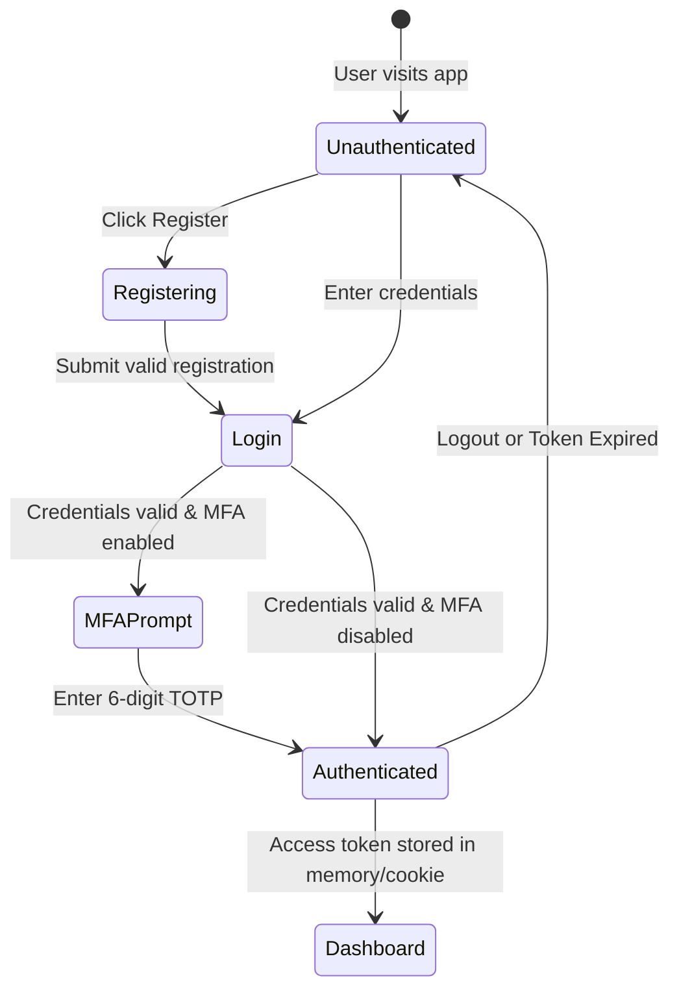
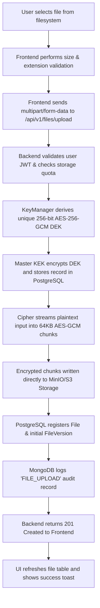

# Milestone 1: UI Wireframes & User Interaction Workflows

**Project**: TrustShare — Intelligent Encrypted File Sharing Platform  
**Milestone**: 1 — UI Wireframes, Workflow Planning & Dashboard Design  

---

## 1. UI Wireframe Layouts

### 1.1 Authentication & Registration Screen Wireframe
```text
+-----------------------------------------------------------------------+
|  [Logo] TrustShare                                                    |
+-----------------------------------------------------------------------+
|                                                                       |
|                     +-----------------------------+                   |
|                     |     [Shield Icon]           |                   |
|                     |   Sign in to TrustShare     |                   |
|                     |                             |                   |
|                     |  Email Address:             |                   |
|                     |  [ alice@company.com      ] |                   |
|                     |                             |                   |
|                     |  Password:                  |                   |
|                     |  [ ****************       ] |                   |
|                     |                             |                   |
|                     |  [x] Remember me            |                   |
|                     |                             |                   |
|                     |  [       Sign In Button    ]|                   |
|                     |                             |                   |
|                     |  Don't have an account?     |                   |
|                     |  < Create an account >      |                   |
|                     +-----------------------------+                   |
|                                                                       |
+-----------------------------------------------------------------------+
```

---

### 1.2 File Management Dashboard & Explorer Wireframe
```text
+-----------------------------------------------------------------------+
| TrustShare | [Files] [Shares] [Audit Logs] [Admin]        [User Avatar] |
+-----------------------------------------------------------------------+
|                                                                       |
|  Encrypted File Manager                                               |
|  Upload, organize, and manage AES-256 encrypted documents             |
|                                                                       |
|  +-----------------------------------------------------------------+  |
|  |                 [Upload Cloud Icon]                             |  |
|  |       Drag & drop files here, or click to browse                |  |
|  |       (Files are automatically encrypted with AES-256-GCM)      |  |
|  +-----------------------------------------------------------------+  |
|                                                                       |
|  [ Search Files...        ]   [ Filter: All Types v ]   [ + New Folder ]
|                                                                       |
|  Current Path: Root / Executive Documents /                           |
|                                                                       |
|  Name                                Size    Version  Last Modified   |
|  -------------------------------------------------------------------  |
|  [Folder] Financial Reports           --      --       2026-08-25     |
|  [Folder] Compliance & Keys           --      --       2026-08-25     |
|  [File] Q3_Strategy.pdf [Lock]        2.4 MB  v3       2026-08-25     |
|         Actions: [Download] [Share] [Version History] [Delete]        |
|  [File] Security_Architecture.png     3.5 MB  v1       2026-08-25     |
|         Actions: [Download] [Share] [Version History] [Delete]        |
+-----------------------------------------------------------------------+
```

---

### 1.3 Version History & Rollback Modal Wireframe
```text
+---------------------------------------------------------------+
|  [History Icon] Version History: Q3_Strategy.pdf          [X] |
+---------------------------------------------------------------+
|                                                               |
|  [Version 3 (Latest)]                                         |
|  Encrypted AES-256 snapshot • 2.4 MB • 2026-08-25 14:30       |
|  [ Download Decrypted Snapshot ]                              |
|                                                               |
|  [Version 2]                                                  |
|  Encrypted AES-256 snapshot • 2.2 MB • 2026-08-20 11:15       |
|  [ Download Decrypted Snapshot ]                              |
|                                                               |
|  [Version 1]                                                  |
|  Encrypted AES-256 snapshot • 2.0 MB • 2026-08-15 09:00       |
|  [ Download Decrypted Snapshot ]                              |
|                                                               |
+---------------------------------------------------------------+
|  [ + Upload New Version ]                       [ Close ]     |
+---------------------------------------------------------------+
```

---

## 2. Core User Workflows

### 2.1 User Authentication & Session Lifecycle


---

### 2.2 File Ingestion, Chunked Encryption & Upload Flow

