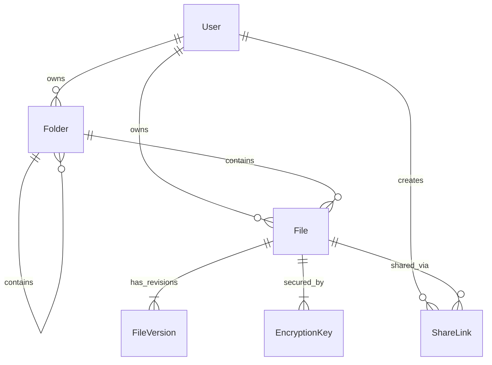
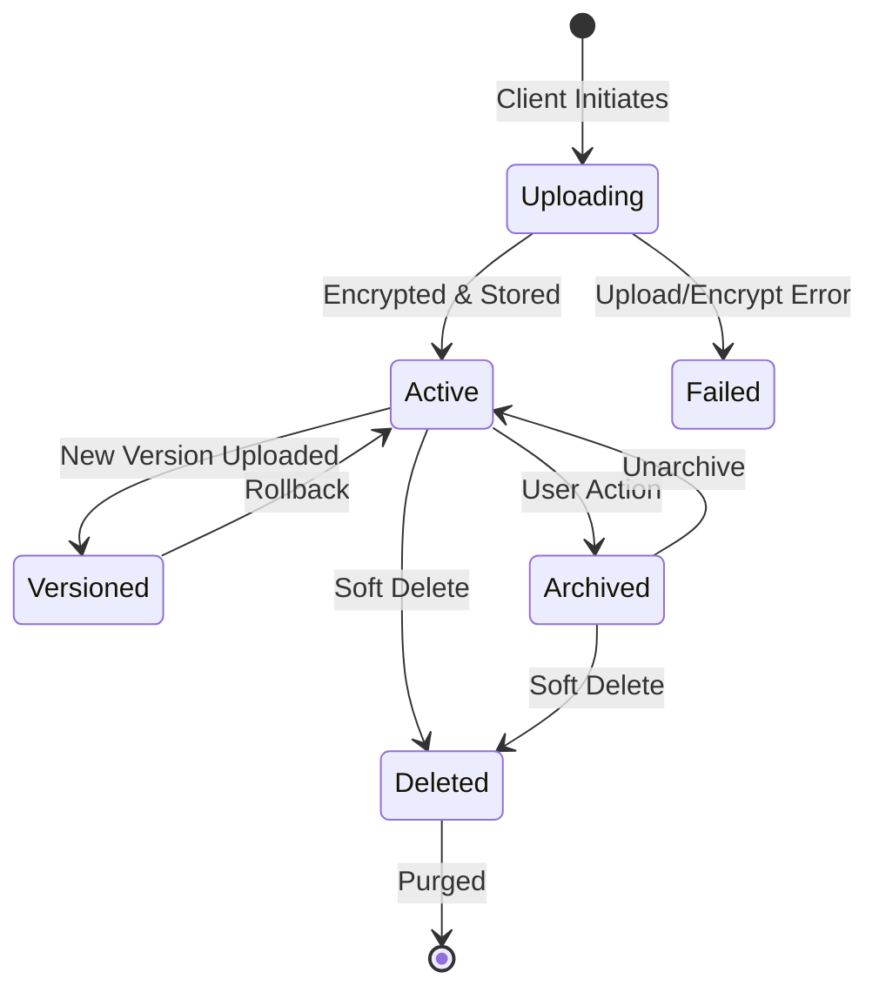
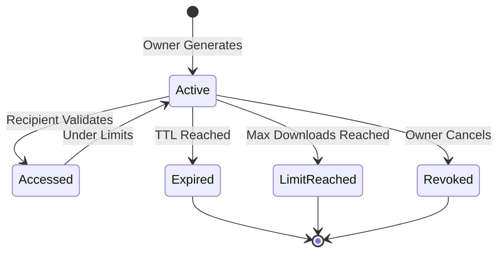

# Data Model: TrustShare Platform

**Feature**: `001-encrypted-file-sharing` | **Date**: 2026-08-25

## 1. Relational Entities (PostgreSQL)

### 1.1 User (`users`)
Represents registered users and platform administrators.

| Column | Type | Constraints | Description |
|---|---|---|---|
| `id` | `UUID` | Primary Key, Default `gen_random_uuid()` | Unique user identifier |
| `email` | `VARCHAR(255)` | Unique, Indexed, NOT NULL | User email address |
| `hashed_password` | `VARCHAR(255)` | NOT NULL | bcrypt password hash |
| `full_name` | `VARCHAR(150)` | NOT NULL | User display name |
| `role` | `VARCHAR(50)` | NOT NULL, Default `'user'` | Role: `admin`, `user`, `viewer` |
| `mfa_enabled` | `BOOLEAN` | Default `FALSE` | MFA activation flag |
| `mfa_secret` | `VARCHAR(64)` | NULLABLE | Encrypted TOTP secret |
| `storage_quota_bytes` | `BIGINT` | Default `10737418240` (10 GB) | Total storage quota |
| `storage_used_bytes` | `BIGINT` | Default `0` | Currently consumed storage |
| `is_active` | `BOOLEAN` | Default `TRUE` | Account operational status |
| `created_at` | `TIMESTAMPTZ` | Default `NOW()` | Registration timestamp |
| `updated_at` | `TIMESTAMPTZ` | Default `NOW()` | Last modification timestamp |

### 1.2 Folder (`folders`)
Represents directory hierarchy for file organization.

| Column | Type | Constraints | Description |
|---|---|---|---|
| `id` | `UUID` | Primary Key, Default `gen_random_uuid()` | Unique folder identifier |
| `name` | `VARCHAR(255)` | NOT NULL | Folder name |
| `owner_id` | `UUID` | Foreign Key (`users.id`), NOT NULL | Owner user identifier |
| `parent_id` | `UUID` | Foreign Key (`folders.id`), NULLABLE | Parent folder ID (NULL = Root) |
| `created_at` | `TIMESTAMPTZ` | Default `NOW()` | Creation timestamp |
| `updated_at` | `TIMESTAMPTZ` | Default `NOW()` | Last update timestamp |

### 1.3 File (`files`)
Represents a logical document asset.

| Column | Type | Constraints | Description |
|---|---|---|---|
| `id` | `UUID` | Primary Key, Default `gen_random_uuid()` | Unique file identifier |
| `name` | `VARCHAR(255)` | NOT NULL, Indexed | Original file name |
| `owner_id` | `UUID` | Foreign Key (`users.id`), NOT NULL | Owning user identifier |
| `folder_id` | `UUID` | Foreign Key (`folders.id`), NULLABLE | Parent folder identifier |
| `mime_type` | `VARCHAR(100)` | NOT NULL | Content MIME type |
| `size_bytes` | `BIGINT` | NOT NULL | Size in bytes |
| `current_version` | `INTEGER` | Default `1` | Active version index |
| `category` | `VARCHAR(50)` | Default `'general'` | File category / tag |
| `status` | `VARCHAR(50)` | Default `'active'` | `active`, `archived`, `deleted` |
| `created_at` | `TIMESTAMPTZ` | Default `NOW()` | Upload timestamp |
| `updated_at` | `TIMESTAMPTZ` | Default `NOW()` | Last modified timestamp |

### 1.4 FileVersion (`file_versions`)
Represents immutable snapshots of historical file revisions.

| Column | Type | Constraints | Description |
|---|---|---|---|
| `id` | `UUID` | Primary Key, Default `gen_random_uuid()` | Unique version identifier |
| `file_id` | `UUID` | Foreign Key (`files.id`), NOT NULL | Associated file identifier |
| `version_number` | `INTEGER` | NOT NULL | Version sequence (1, 2, 3...) |
| `size_bytes` | `BIGINT` | NOT NULL | Version payload size in bytes |
| `storage_path` | `VARCHAR(512)` | NOT NULL | Encrypted storage blob path |
| `encryption_key_id` | `UUID` | Foreign Key (`encryption_keys.id`) | Key used for encryption |
| `checksum_sha256` | `VARCHAR(64)` | NOT NULL | Encrypted blob SHA-256 hash |
| `uploaded_by` | `UUID` | Foreign Key (`users.id`), NOT NULL | User who uploaded revision |
| `created_at` | `TIMESTAMPTZ` | Default `NOW()` | Revision upload timestamp |

### 1.5 EncryptionKey (`encryption_keys`)
Stores encrypted Data Encryption Keys (DEKs) encrypted by a Master Key (KEK).

| Column | Type | Constraints | Description |
|---|---|---|---|
| `id` | `UUID` | Primary Key, Default `gen_random_uuid()` | Unique key identifier |
| `file_id` | `UUID` | Foreign Key (`files.id`), NOT NULL | Associated file identifier |
| `encrypted_dek` | `BYTEA` | NOT NULL | Encrypted AES-256 key payload |
| `iv_nonce` | `BYTEA` | NOT NULL | 12-byte initialization vector / nonce |
| `algorithm` | `VARCHAR(50)` | Default `'AES-256-GCM'` | Cryptographic algorithm |
| `key_version` | `INTEGER` | Default `1` | Key lifecycle version |
| `created_at` | `TIMESTAMPTZ` | Default `NOW()` | Generation timestamp |

### 1.6 ShareLink (`share_links`)
Represents an active, protected sharing grant.

| Column | Type | Constraints | Description |
|---|---|---|---|
| `id` | `UUID` | Primary Key, Default `gen_random_uuid()` | Unique link identifier |
| `file_id` | `UUID` | Foreign Key (`files.id`), NOT NULL | Shared file identifier |
| `created_by` | `UUID` | Foreign Key (`users.id`), NOT NULL | Grantor user identifier |
| `token_hash` | `VARCHAR(64)` | Unique, Indexed, NOT NULL | SHA-256 hash of share token |
| `permission_type` | `VARCHAR(50)` | NOT NULL | `view_only`, `download_allowed` |
| `hashed_passphrase`| `VARCHAR(255)` | NULLABLE | Optional bcrypt passphrase |
| `max_downloads` | `INTEGER` | NULLABLE | Maximum download count |
| `current_downloads`| `INTEGER` | Default `0` | Executed downloads count |
| `expires_at` | `TIMESTAMPTZ` | NOT NULL | Expiration timestamp |
| `is_revoked` | `BOOLEAN` | Default `FALSE` | Manual revocation flag |
| `created_at` | `TIMESTAMPTZ` | Default `NOW()` | Link creation timestamp |

---

## 2. Document Entities (MongoDB)

### 2.1 AuditLog (`audit_logs`)
Append-only collection tracking all security and data operations.

```json
{
  "_id": "ObjectId",
  "event_id": "UUID",
  "timestamp": "ISO8601 Date",
  "actor": {
    "user_id": "UUID | null",
    "email": "string | null",
    "role": "string",
    "client_ip": "string",
    "user_agent": "string"
  },
  "category": "AUTH | FILE | SHARE | SECURITY",
  "action": "LOGIN | UPLOAD | DOWNLOAD | SHARE_CREATE | SHARE_ACCESS | REVOKE | KEY_ROTATE",
  "resource": {
    "resource_type": "file | folder | share_link | user",
    "resource_id": "UUID",
    "resource_name": "string"
  },
  "status": "SUCCESS | FAILURE | DENIED",
  "details": {
    "reason": "string | null",
    "bytes_transferred": 1048576,
    "share_token_prefix": "string"
  }
}
```

### 2.2 SecurityAlert (`security_alerts`)
Stores real-time threat alerts and anomaly detections.

```json
{
  "_id": "ObjectId",
  "alert_id": "UUID",
  "timestamp": "ISO8601 Date",
  "severity": "LOW | MEDIUM | HIGH | CRITICAL",
  "type": "BRUTE_FORCE_PASSPHRASE | SUSPICIOUS_IP | BULK_DOWNLOAD | QUOTA_EXCEEDED",
  "target_user_id": "UUID",
  "source_ip": "string",
  "description": "string",
  "acknowledged": false,
  "acknowledged_by": "UUID | null"
}
```

---

## 3. Entity Relationships Diagram



---

## 4. State Machines & Transitions

### File Lifecycle State Machine


### Share Link Lifecycle State Machine

